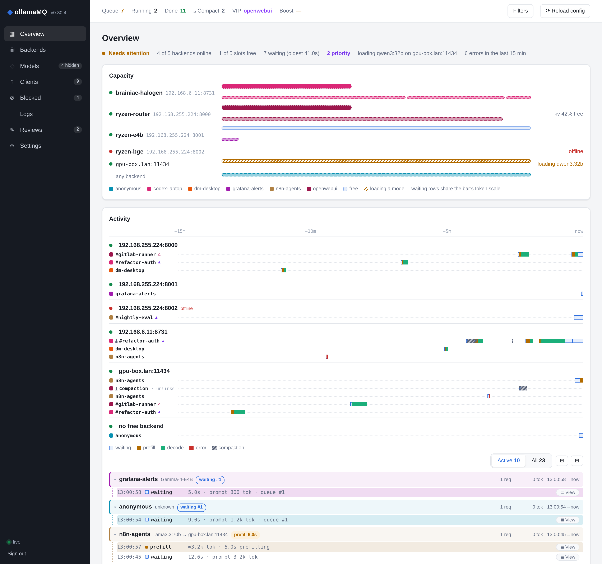

# ollamaMQ

**One endpoint for all your GPU boxes.** ollamaMQ is a queueing proxy for [Ollama](https://ollama.com/), [LM Studio](https://lmstudio.ai/) and OpenAI-compatible servers (llama.cpp, vLLM, …). It gives every user a fair turn, sends each request to the backend that already has the model loaded, keeps a conversation on its warm KV cache, and shows you what's happening while it does.


<a href="docs/web-ui.md">
  <picture>
    <source media="(prefers-color-scheme: dark)" srcset="docs/images/activity-dark.png">
    
  </picture>
</a>

## Why

A few machines with GPUs, several people and a handful of coding agents all pointing at them: without a traffic cop, one agent loop hogs a box, requests pile onto the server that has to load a model from disk, and a 60-turn conversation re-prefills its whole context every time it lands somewhere new. ollamaMQ sits in front, queues per user, routes with the model and the cache in mind, and puts it all on one live dashboard.

## Highlights

- **Fair queues** — every user or API key gets its own queue; a fair-share scheduler takes turns by recent load, so nobody monopolises the hardware. VIP, boost and per-conversation priority when you need them.
- **Smart routing** — requests go only to backends that serve the model, preferring the one where it is already loaded. Ollama and OpenAI-style APIs on one port; model lists are merged from every backend.
- **Warm caches** — sticky sessions keep a conversation on the backend that holds its context, and cache-aware scheduling stops agents from evicting each other on every turn.
- **Live dashboard** — see each backend's capacity, every conversation's waiting, prefill and decode on a timeline, and open any conversation as a readable transcript.
- **Clients and keys** — hand out API keys per client, block or prioritise them, hide models, load and unload models, all from the web UI.
- **Conversation log and review** — a compact per-conversation log, with optional redaction, and one-click LLM review of any conversation that runs only when the hardware is idle.
- **Security audit** — flags prompt injection, exfiltration and similar patterns in agent traffic. It only marks them and never blocks anything.
- **Prometheus metrics** — requests, tokens, latency, queue depth and cache waste, per client and per model.

## Quick start

### Docker Compose

```bash
mkdir -p ollamamq/config ollamamq/logs && cd ollamamq
curl -O https://raw.githubusercontent.com/dmarchevsky/ollamaMQ/master/docker-compose.yml

cat > config/appconf.yaml <<'EOF'
backends:
  - http://host.docker.internal:11434   # your Ollama / LM Studio / llama.cpp servers
settings:
  host: 0.0.0.0
  request_log_path: ../logs/ollamamq-requests.jsonl
EOF
echo 'OLLAMA_MQ_UI_PASSWORD=change-me' > config/.env

docker compose up -d
```

The proxy is now on **http://localhost:8081**, and the dashboard at **http://localhost:8081/ui** (user `admin`). A backend on the Docker host has to listen on `0.0.0.0` (for Ollama, `OLLAMA_HOST=0.0.0.0`).

### From source

```bash
cargo install --git https://github.com/dmarchevsky/ollamaMQ
OLLAMA_MQ_UI_PASSWORD=change-me ollamaMQ --backend-urls http://localhost:11434,http://gpu-box:11434
```

It listens on `127.0.0.1:11435` by default. See [Deployment](docs/deployment.md) for systemd and other setups.

## Point your clients at it

Use ollamaMQ wherever you'd use the Ollama or OpenAI base URL. Tell it who is asking with an API key (create one under **Clients** in the web UI) or an `X-User-ID` header:

```bash
# Ollama API
curl http://localhost:11435/api/chat -H "X-User-ID: alice" \
  -d '{"model": "qwen3:32b", "messages": [{"role": "user", "content": "Hello!"}]}'

# OpenAI API, with a client key and a readable session name
curl http://localhost:11435/v1/chat/completions \
  -H "Authorization: Bearer omq-…" -H "X-Session-Name: refactor-auth" \
  -d '{"model": "qwen3:32b", "messages": [{"role": "user", "content": "Hello!"}]}'
```

Without a key or `X-User-ID`, requests queue per client IP address.

## Documentation

| | |
| --- | --- |
| [Configuration](docs/configuration.md) | `appconf.yaml`, command-line flags, environment variables, model aliases, decision-model backends |
| [Deployment](docs/deployment.md) | Docker, Docker Compose, systemd, logging |
| [API](docs/api.md) | endpoints, request headers, authentication, model load/unload admin API |
| [Web UI](docs/web-ui.md) | the dashboard pages, clients and API keys, model filtering, settings |
| [Routing and scheduling](docs/scheduling.md) | load balancing, fair share, sticky sessions, priorities, cache-aware hold-back, context compaction |
| [Request log](docs/request-log.md) | the conversation log format, redaction, retention, export |
| [Conversation review](docs/review.md) | sending conversations to an LLM for review |
| [Security audit](docs/security-audit.md) | what the audit flags, and how to configure it |
| [Metrics](docs/metrics.md) | Prometheus metrics and example queries |

The [changelog](CHANGELOG.md) lists what changed in each release.

## Development

```bash
cargo clippy --all-targets -- -D warnings  # CI treats every lint as an error, so run it before pushing
cargo test                                 # unit tests: routing, sessions, queueing, the log
bash tests/e2e/run.sh                      # model load/unload and the admin gate, against mock backends
bash tests/e2e/audit_run.sh                # the security audit on streamed replies
```

The Rust toolchain is pinned in `rust-toolchain.toml`, so local and CI clippy always agree. To try the web UI without a proxy, open `src/web/index.html?demo=1` in a browser. It runs on built-in sample data.

## License

MIT. See [LICENSE](LICENSE).
