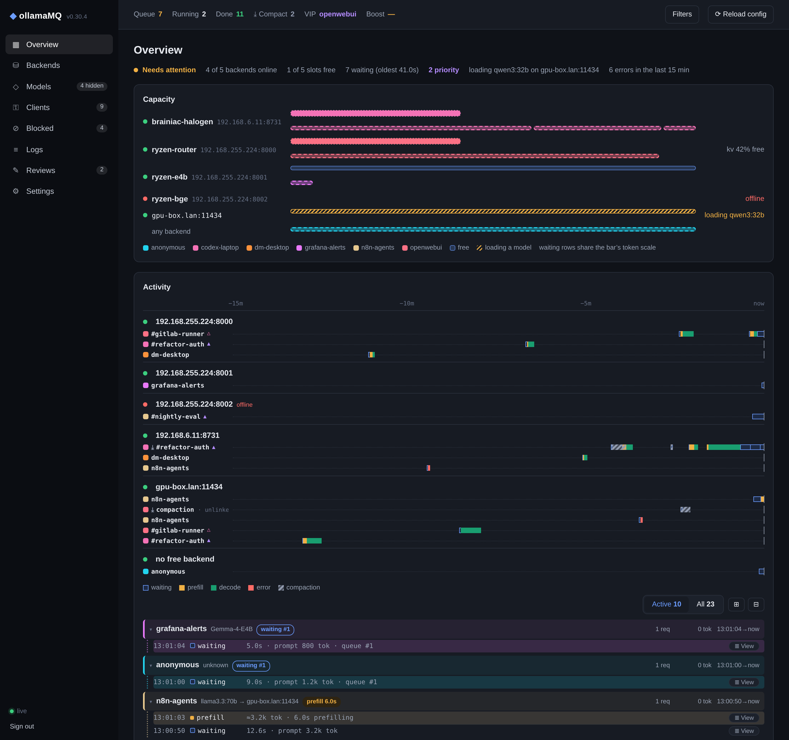

# Web UI

[← Back to README](../README.md)



## Signing in

Set a password and open `http://<host>:11435/ui/`:

```bash
OLLAMA_MQ_UI_PASSWORD=change-me ollamaMQ     # user defaults to "admin"
```

The web UI is **off** unless a password is configured (`OLLAMA_MQ_UI_PASSWORD`, or `settings.web_ui.password` in `appconf.yaml`). Browsers sign in on `/ui/login`, which sets a session cookie (`HttpOnly`, `SameSite=Strict`, `Secure` when the proxy in front sends `X-Forwarded-Proto: https`) valid for 7 days; **Sign out** is in the sidebar. Sessions are kept in memory, so restarting ollamaMQ signs everyone out. After 10 failed sign-ins within 10 minutes further attempts get `429` until the window passes. Scripts can skip the page and send the same user and password as HTTP basic auth to `/ui/api/*`. This is all independent of `OLLAMA_MQ_API_KEY`. The password crosses the network at sign-in, so put the UI behind TLS (a reverse proxy) when it is reachable from beyond a trusted network.

## Pages

The dashboard covers:

- **Overview** — status at a glance over a selectable interval (default 15 min, up to `history_hours` — see below)
- **Backends** — health, API type, load, and per-backend model lists with **Load** / **Unload**; also where backends are configured: **Add** (with **Test connection**), name, token, **Disable/Enable**, **Remove**, and whether the backend's response text is stored in the log (see [Request logging](request-log.md))
- **Clients** — every queue identity with its queue depth and counters; **VIP**, **Boost**, **Block**, **Block IP**, **Unblock**. Registered clients are two levels: open a row to edit or delete its keys
- **Models** — every model the backends list, with a switch per model and filter rules (below)
- **Blocked** — disabled clients, blocked ids and blocked IPs
- **Logs** — the request log, by conversation or by request, and the conversation viewer — see [Logs and the conversation viewer](#logs-and-the-conversation-viewer)
- **Reviews** — conversations sent to an LLM review (**✎ Review** in the conversation viewer): each one's status — queued with the reason it waits, running and where, done, failed with the backend's answer — and the review itself, with the prompt it was sent with; **Run now**, **Re-run**, **Retry**, **Cancel**, **Delete**, and the prompt library under **Prompts…** (see [Conversation Review](review.md))
- **Settings** — limits, model aliases, metrics token, the admin password, and the version you are running (see below)
- **Reload config** — re-read `appconf.yaml`

## Overview and Activity

The **Overview** page shows:
- a one-line health summary
- a **Capacity** board: one proportional bar per backend — solid client-coloured segments for the running requests (width ∝ the request's estimated size) and clearly visible free slots; waiting requests get a slim row under the bar on the same token scale, so a backlog visibly passes the backend's end. Where a backend reports its KV cache (a llama.cpp server started with `--metrics`), the free space is sized by it; elsewhere free slots split the remainder equally
- a **Filters** button in the top bar: the modal picks the time interval (presets up to the configured `history_hours` — 24 h and 48 h appear when the retention covers them — or "last N minutes/hours" up to that same ceiling), whether clients are listed bare or as `client:key` (the API key label — lanes, rows and the Clients table then read e.g. `codex-laptop:gen`), and multi-select client, backend and model lists. The selection scopes every panel on the page — Queue, Running, Done, Capacity, Activity and both tables (free slots and backend health stay backend-wide, they are not anybody's) — **and the Logs list as well**: its window, clients, models and backends (a captured row knows no API key and no priority, so those two axes stay Overview-only and a `client:key` choice scopes Logs by the client). It is remembered per browser, so one choice reads the same on both pages and after a reload; the button dots while anything deviates from the defaults and its tooltip names the current scope. While the scope is biting on Logs, the toolbar carries a chip saying which (`48 h · 1 clients`), an emptied list names the filter that emptied it, and a window wider than the log ring says how far back the list actually reaches instead of implying it looked further
- an **Activity** panel. The graph is one row per conversation, grouped under the backend it ran on: each request paints one block per stage — **waiting** (queued for a slot, hollow blue), **prefill** (yellow), **decode** (green) — placed at the moment that stage began and as wide as it ran, so a 40s decode reads as forty seconds next to a 1s prefill. Colours mean the stage and nothing else; the client's own colour is the swatch beside its name, and identity hues deliberately avoid every status hue so a swatch can never be misread as a stage. A conversation that goes quiet leaves a gap on its row, and a stage cut off by an edge of the window is clipped there and marked `‹`. Hovering a lane lights the whole row in its client's colour — and lights that conversation's header in the list below in the same colour, so the two places a conversation is drawn read as one thing; hovering a header lights its lane back. Nothing scrolls on hover. Below the graph the list threads each conversation: one block per conversation, one line per stage event with its own timestamp, plus an `idle` line where the conversation sat quiet. Graph and Details list conversations by when each session **started** (newest first), one shared order, so a running session never jumps around; **Active** shows running and waiting, **All** adds the recently finished, and **⊞ / ⊟** expand or collapse every conversation at once. The conversation header carries what a stage line cannot: request count, tokens, the span it covers, and — while it is active — the rates it is being served at: `decode 88.7 t/s` from the live stream and `prefill 349 tok/s` measured on the last finished request there (a request cannot time its own prefill: by the time the first token proves anything it is already decoding, so while the first token is still out the header shows `prefill 4.2s` and puts the last measured rate in its tooltip), or `waiting #2`. Each header ends with the same `≣ View` chip the stage lines below it carry — same 11 px face, same pill size, and the rows carry the header's right inset so the chips fall in one column instead of a ragged edge. Live lines wash in the client's colour, while the graph reserves that wash for hover. Clicking a graph row focuses that conversation in the list below. Sessions come from sticky routing: the client's `X-Session-Id` header, its `prompt_cache_key`, or a fingerprint of the conversation (see [Sticky Routing](scheduling.md#sticky-routing-session-affinity)). A conversation that ran out of context shows it: its summarization call is one striped graphite block on that same row (never a mystery session of its own), the row is marked `⤓`, and the top bar counts `⤓ Compact N` — conversations that compacted in the window (see [Context Compaction](scheduling.md#context-compaction))
- **Backends** and **Clients** tables with requests, errors, first-token p50/p95, generation and prefill speed, and token totals

Numbers cover the chosen interval and come from a history of the last `history_hours` (default 24), newest `history_max_records` requests (finished requests, plus what is running or queued right now). Finished requests are journalled next to the request log (`ollamamq-activity.jsonl`, size-rotated like it), so the Overview keeps its curve across a restart; what falls out at the retention boundary is not replayed. Request sizes are estimated as one token per four body bytes while queued or running — the exact prompt count only arrives with the finished response. Every stage line in **Details** and every conversation header carries a `≣ View` chip: either opens the conversation viewer — the stage line on that request, the header on the whole conversation. Because stage times are stamped where they happen, an `idle` line between two turns can name what ran inside it (`idle 2m 30s · tool edit`) instead of leaving you to infer it from durations.
- *First token* is measured from dispatch to the first generated token for streams, or is the prompt time the backend reports for non-streamed responses.
- *Generation speed* is per stream (median).
- *Share of slot time* is each client's part of the backend time used in the window, which is what fair scheduling divides.

## Backends

The **Backends** page lists the configured backends and edits the backend list while the proxy runs (saved into `appconf.yaml`, same rules as Settings):
- **Adding** a backend probes it within 10 s. **Test connection** shows its type, slots and models before you add it.
- **Disabling** one stops new requests at once; running ones finish.
- **Removing** one disables it now and drops it from the list at the next restart.
- **Names:** a backend can have a **name** (`backends: - url: …` with `name: gpu-box` in `appconf.yaml`, or in the UI). The UI shows the name instead of `host:port`. Prometheus keeps `backend="host:port"` and adds `ollamamq_backend_info{backend, name}` for dashboards.
- **Log capture:** a backend can be marked **Redact log — do not save response text** (`redact_log: true` on its entry, shown as a `redacted` badge in the list). Its requests still log an entry with status, size and timing — only the response text is left out. See [Request logging](request-log.md).
- **`--backend-urls`:** when given, the list is fixed and the page shows it read-only.

## Settings

The **Settings** page edits `appconf.yaml` itself while the proxy runs.
- **The file is rewritten on save** — comments and custom formatting do not survive it; the previous version is kept as `appconf.yaml.bak`. The process must be able to write `appconf.yaml`.
- **Precedence:** command-line flags and environment variables > `appconf.yaml` > built-in defaults. A value set on the command line or in the environment shows as locked.
- **Source:** each setting shows where its value comes from, and **Use the default value** removes it from the file.
- **Undo last save** restores the previous `appconf.yaml`, kept as `appconf.yaml.bak` (undo again redoes).

**What applies at once:**
- **Live:** timeouts, slots and queue limits, model aliases, keyless IP identity, unknown-route proxying, and the metrics token.
- **After a restart:** largest request body.
- **Read-only:** listen address, log files and store paths. Set these in `appconf.yaml`.

**Admin password:**
- **Change password** stores an argon2id hash as `settings.web_ui.password_hash` in `appconf.yaml`.
- **Precedence:** the hash wins over `OLLAMA_MQ_UI_PASSWORD` and `settings.web_ui.password`. Those become the first-run password.
- **Sessions:** other sessions are signed out.
- **Forgot it?** Delete `password_hash` from `appconf.yaml` and restart; the configured password works again.

## Logs and the conversation viewer

log events newest-first: the live stream, filled underneath by the Activity journal, so a restart opens the panel with its retained history (`ollamamq-activity.jsonl`) instead of a blank page — restored rows open their conversation straight from the log file like any other row, however deep in the rotated chain it sits. The panel shows **everything the window holds** — it is a time window, not a count: no `limit` trims it, so a 48 h scope really lists 48 h of traffic, and the only ceiling is the request log's own retention. When the window asks for more than the chain can answer, a note above the list names how far back it actually reaches (`The window asks for 48 h; the log chain reaches back to 09:14 …`) A row whose conversation the log can no longer open is greyed, and its tooltip names the reason it is grey — removed by retention (`raise request_log_max_total_bytes` / `request_log_max_days` to keep more) or deleted, capture switched off, or the index still filling after a start — instead of offering a click with nothing behind it. The console log (`RUST_LOG`, stderr) is the full record. 

**By conversation** (default): one row per conversation — what a session did, instead of twenty rows that each repeat part of the last one. The row names the client and the session as its client named it (`#cache-warmup`, or the six-hex tag when nothing labelled it) and sums the traffic in an Activity line (`→ 4 req · 1.3 MB ← 200 · 92 KB`, with `waiting` or `2 failed` when either is true). **By request**: one row per request round (`→ request · ← response`), which is what you need when a single call misbehaved. In both views a CTL action and traffic that sent no session token stand alone as their own rows, and a round whose body text was switched off (by client/key/backend rule or by the request's own `X-Redact-Log` header) is marked `redacted`. The choice is remembered like the other view choices.

Clicking a row opens the **conversation viewer** on that conversation — a grouped row lands on its newest request, a per-request row on the request clicked. **The address bar names what you opened** (`#logs?rid=904&conv=codex-laptop%23a3f19c`): copy it out of the browser and paste it into another machine's browser (one that already has a session) — same window, same conversation, no copy button to build — and stepping `⏮ ‹ › ⏭` keeps it current; closing the viewer hands the address back. A pasted link whose conversation aged out says so in a toast instead of opening an empty modal.

The viewer draws every turn of the conversation as a block on one timeline, each headed by what was measured — `queued 0.6s · prefill 6.4s · gen 11.0s · 31.4 t/s` — with any quiet stretch of 5 s or more between two turns called out as `idle 55s · tool read (10:38:07 → 10:39:02)`, because those are the tool results the next request carries. The focused turn is expanded: its messages as a transcript (thinking collapsed, tool calls rebuilt, token footer), showing only what the request added. Everything it merely re-sent collapses into one line — `▸ 7 messages held from request 1 · system 1 · user 2 · assistant 2 · tool 2 · ≈799 B — show them here too` — because the turns above already drew those messages; click the line to see them inside this request as well. The request line counts both halves: `10 messages · 3 new this turn`. Other turns stay as header lines until opened. Requests between two final answers are wrapped as a **run** — named only by the range it covers (`#1–#3`, how long it ran, tool calls fired) — because a tool loop is one job, not five requests; the run folds as a unit, and a problem (an HTTP error, a timeout) tints every row it touches. Every message block folds on its label click: the system prompt starts folded to one line, so the transcript opens on what the conversation said, not on the harness prompt every request repeats. A streamed response is read back as the answer it produced, not as the wire it came over: the viewer reassembles the SSE (or Ollama line-JSON) chunks into one assistant message — text, collapsed thinking, rebuilt tool calls, finish reason and usage — and drops keep-alive comments, empty deltas and the `[DONE]` marker. There is no Raw/Formatted switch: the transcript is the view, and the wire is what `⤓` hands you. A stream that opens with `: keepalive` is still a stream. `⏮ ‹ › ⏭` walk request by request (the one you clicked from is where it starts), `⟳` reloads to pull in turns that arrived since — keeping your scroll place and open blocks — and an **Auto-refresh** checkbox does the same quietly every few seconds; an **Incremental** checkbox (on by default) picks whether each request shows only what it added or the full prompt with the re-sent history dimmed.

**`⤓ Raw log` saves the capture itself**: the whole conversation as one JSONL line, fetched in one request — every turn's `content.req` whole and `content.resp` as stored (the SSE frames of a turn still in memory or of one that failed, the folded completion of a flushed one), the redactions — nothing rendered, nothing dropped, the record you file a bug with (`ollamamq-<client>-<session>-<stamp>.jsonl`). **Delete** (twice, to confirm) removes the conversation from the log.

`≡ Jump` opens the request tree — drag its left edge to make it wide or narrow (double-click, or focus the edge and use `←`/`→`, to reset), and the width is remembered like the other viewer choices — run → the messages a request sent and the answer it got → tool call, folding per request — and it is the *same* fold as the request's header in the body: closing it in the tree closes the block, closing the block closes the tree, and `Expand all` / `Collapse all` move both. An opened request groups its rows under two tinted heads: `REQ` for what it **sent** (`→ 636 KB · 7 new`) and `RESP` for what it **got** (`7.0s ← Fixed by walking the chain…`) — the reply *is* that head, so there is no second assistant row underneath it, and a reply the next request re-sent is not repeated as a message row either. A head lands on its half of the turn in the body. The tree also follows the wheel: whichever block sits at the top of the log lights its row there. Each request lists only the messages it added — the re-sent ones live under their own request, and the body's one-line history is where you open them. It is stamped the way `dmesg -H` stamps a log: the conversation's first request owns the absolute clock (`17:30:14`), and every stamp after it counts **continuously from the conversation's start** — request 2 at `+18s`, request 3 at `+31s`, never the same number twice — and the one rule for the whole column is **`+` means a moment, a plain number means a length** — a request row is a moment (`+31s` after the conversation began), a response row is how long that response took (`18.4s`), an idle row how long it sat quiet (`6.2s`), a message row the window that produced it. Hover any of them and it says which it is. There is no third kind: a `TOOL` result is the stretch between the previous answer ending and this request arriving (`2.0s`, tooltip `produced between 14:53:02 and 14:53:57`), an `ASST` row is the generation that wrote it. The absolute time of any later row stays one hover away. A row that owns no moment of its own (`SYS`, `USER`, a request before its answer arrived) renders no clock cell at all — an empty column aligned with nothing only steals room from the snippet — and a length a row *does* own rides after its label (`RESP 7.0s`). Indent is one hairline group guide per level, and any row under the pointer takes a grey band, so the message rows are as evidently clickable as the heads. Clicking any row lands on its block's first line in the body and highlights the row you are looking at — for a message the request merely re-sent, that is the earlier turn where it is drawn, unless this request has its held history unfolded, in which case the copy in front of you is the one you land on.

Capture turned off is rendered as structure, not absence: the blocks, timeline, sizes and message roles are all there, with *text redacted* where the text would be. The page behind never scrolls while the viewer is open — the only scrollbar is the log's own (the tree clips instead). Truncated captures are salvaged rather than shown as raw. A request that summarizes a conversation names itself on the line (`body=285694B · compaction`), its conversation row counts them as `⤓ N`, and the viewer marks the turn itself — redacted text or not (see [Context Compaction](scheduling.md#context-compaction)).

## Clients and API keys

The **Clients** page is one list with two levels (filter with *All / Registered / Unregistered*): a row per id, and — while that row is open — the client's keys beneath it. *Expand all / Collapse all* works over the whole list.

- **Registered clients** are created in the UI and saved in `clients.yaml`. They authenticate with their API keys and are listed even when idle.
- **Unregistered ids** are what requests without a key are queued under: their `X-User-ID`, or the IP a front proxy fills in, else `anonymous`. The value is sanitised before it is used — clipped to 64 characters, control characters and runs of whitespace collapsed to `-`, and anything outside printable ASCII dropped — because it arrives from the client and is shown in the dashboard and in metrics labels verbatim otherwise. `:` is stripped so no caller can forge the namespace the proxy reserves for its own identities. The header itself still reaches the backend unchanged. They live in memory and drop off the list after an hour idle. **Register** turns one into a client of the same name and opens the add-key dialog.

- Create a client (its name becomes its queue id), then add keys — **generated** (`omq-…`) or **any string you choose** (8–256 printable characters, unique across clients). A key is opened from its row to **edit** (label, log capture) or **delete**; a client can be renamed, disabled (its keys get `403`) or deleted. A key always belongs to the client it was created for — moving one means deleting it and handing out a new one.
- Each client row carries **VIP**, **boost**, **Block IP**, **+ Key** and **Disable**/**Enable**; each key row carries **Edit** and **Delete**.
- A request carrying a client key (`Authorization: Bearer <key>` or `X-Api-Key: <key>`) queues under that client's name, **whatever `X-User-ID` it sends**. The key is removed before the request is forwarded, so it never reaches a backend (the backend's own `token` applies instead).
- Requests with no key, or a key no client owns, are queued by `X-User-ID` — **except that registered names are reserved**: a keyless request claiming one (e.g. `X-User-ID: alice` without alice's key) is queued apart as `unverified:alice`, with none of alice's queue position, priority or stats.
- **Blocking a registered client disables it** (*Block* / *Disable* in the web UI): its keys get `403` and its queued requests are dropped. That is the client's one block switch, saved with it; a user block on a client name from before this rule is converted to *disabled* at startup. Unregistered ids and IPs are blocked as before (`blocked_items.json`).
- **VIP and boost on a registered client are saved** with it and restored at startup; on an unregistered id they last until restart.
- **Renaming a client moves its live state** — queued requests, counters, last IP, fair-share position, VIP/boost — to the new name. Requests already being served finish under the old name. Deleting a client turns its name back into an ordinary id and clears its VIP/boost.
- Keys are stored in plaintext in `settings.clients_file` (default `clients.yaml` next to `appconf.yaml`) so they can be looked up again; the file is written owner-only (`0600`). Changes are saved immediately (atomic replace). A clients file that exists but cannot be parsed stops the proxy at startup rather than being overwritten. The file is hand-editable YAML — a key may be written as just its string (`- omq-…`); ids and timestamps are filled in when the proxy saves it.

  ```yaml
  clients:
    - name: codex-laptop
      redact_log: true      # keep the log entries, store no body text (see Request logging)
      keys:
        - key: omq-7f3a9c41d2e8b6057a1c9e3f4b2d8a60
          label: laptop
        - key: codex-review-2026
          label: auto-review
          redact_log: true  # same switch per key; a key can only opt out, never back in
  ```

## Model filtering

The **Models** page decides which models the proxy serves. Rules are case-insensitive globs (`*` any run of characters, `?` one character) matched against the model names backends list, for every backend or only some:

- **Hide** rules always win. **Allow** rules matter only in *Serve only allowed* mode; the default mode, *Serve all except hidden*, serves every model no hide rule names. Switching modes is safe: rules of the other kind are kept and come back when you switch back.
- A model's switch adds or removes an exact-name rule. A model still hidden by a pattern rule cannot be switched on from the list — remove or narrow the pattern.
- Hidden models are left out of the merged `/v1/models` and `/api/tags`, and a request naming one (in the body, or the path of `/v1/models/{id}`) gets **`404 model not found`** at once, in OpenAI or Ollama error shape. Matching follows routing, so `llama3` cannot reach a hidden `llama3:latest`.
- A rule limited to some backends hides the model there only; requests route to the backends that still serve it.
- Model load/unload from the web UI still works on hidden models (to warm one before serving it). `/api/ps` is not filtered.
- Rules are stored in `settings.models_file` (default `models.yaml`), written atomically. A file that exists but cannot be parsed stops the proxy at startup rather than serving everything. It is hand-editable YAML — a plain hide rule may be written as just its pattern (`- unsloth/Qwen3.8-27B-GGUF:*`).
